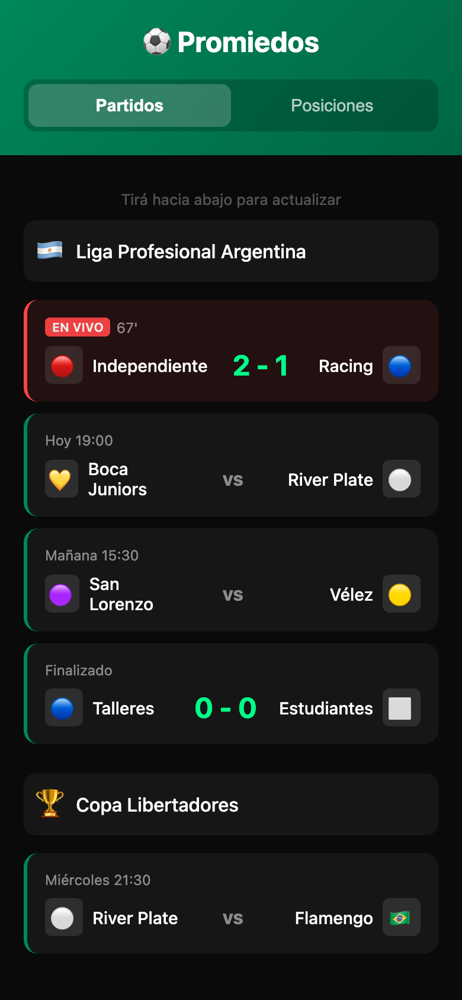
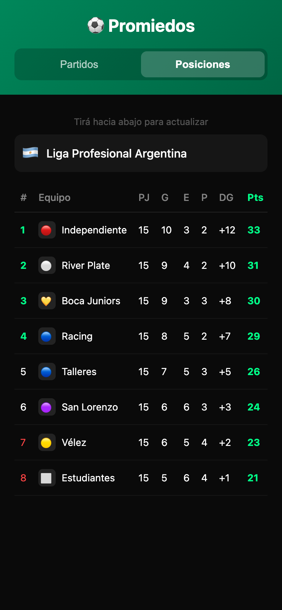

<div align="center">

# ⚽ Promiedos

**A mobile UI prototype for following Argentine football: matches, live scores and league standings.**

[](https://nico-sanchez.github.io/nico-apps-promiedos/)
[](https://github.com/Nico-Sanchez/nico-apps-promiedos/actions/workflows/pages/pages-build-deployment)


&nbsp;&nbsp;


</div>

> [!NOTE]
> This is a design prototype. Matches and standings are **hard-coded sample data**, not live results.
> It is a personal project and is not affiliated with promiedos.com.ar.

## What's in it

- **Partidos** — match cards grouped by competition (Liga Profesional, Copa Libertadores), with a highlighted *EN VIVO* card, upcoming kick-off times and final scores.
- **Posiciones** — league table with played, won, drawn, lost, goal difference and points.
- **Pull to refresh** — swiping down from the top reloads the page.
- **PWA shell** — manifest and service worker so it can be added to the home screen.

## Roadmap

- [ ] Fetch real fixtures, results and standings from a football data API
- [ ] Relegation averages (*promedios*) table
- [ ] More competitions

## Run locally

```bash
python3 -m http.server 8000
```

Then browse to <http://localhost:8000>.

## More apps

Part of a small collection of web apps — see the [apps landing page](https://nico-sanchez.github.io/apps-landing/).
